<p align="center">
  
</p>

<p align="center">
  <a href="https://jamal-portfolio-kappa.vercel.app/"></a>
  <a href="https://github.com/Ansari1jamal"></a>
  
</p>


## `▸ PLAYER STATS`

```text
PLAYER ........ Jamal Ahmad Ansari
CLASS ......... Full-Stack Developer
BASE .......... Prayagraj, India
MAIN WEAPON ... React + Node.js + PostgreSQL
SPECIAL ....... ships full-stack apps end to end — UI, API, database, deploy
SIDE QUEST .... building production-grade systems
STATUS ........ ● open to opportunities
